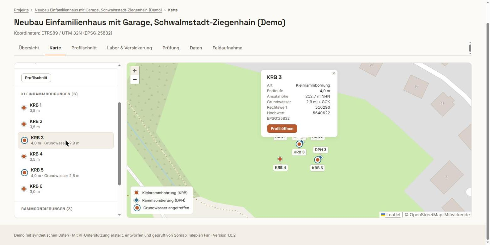
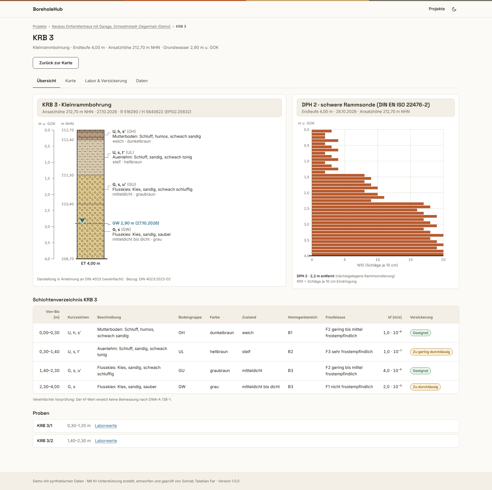
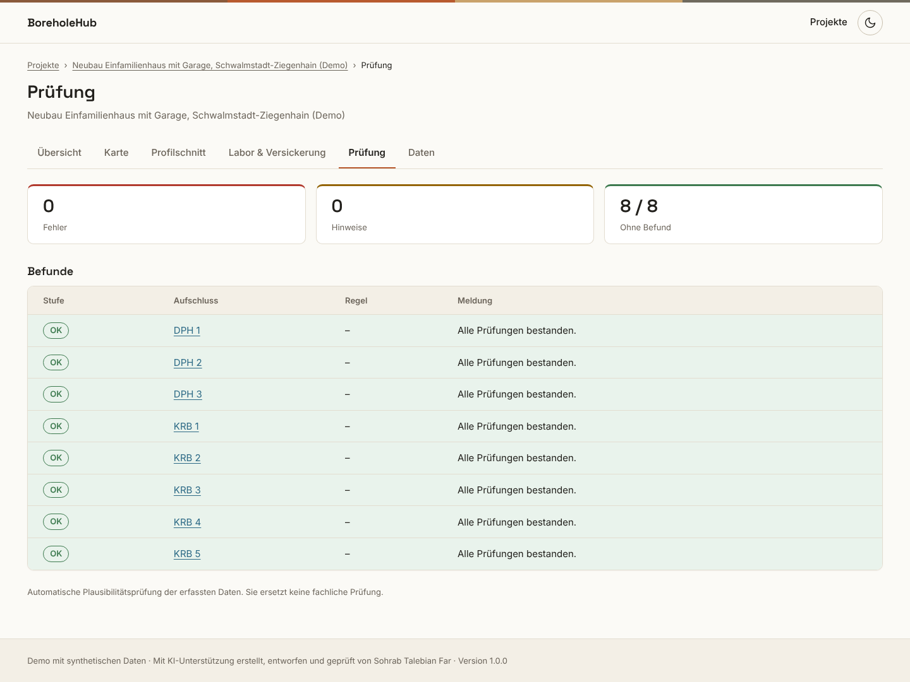

# Unterlagen für das Gespräch mit Erde & Boden Mitteldeutschland GmbH

Bewerbung als Geologe (GIS) · Zoom-Gespräch am Samstag, 21. November 2026

Sehr geehrter Herr Hoffmann, sehr geehrter Herr Höppner,

vielen Dank für die Einladung zum Gespräch. Hier finden Sie alle Unterlagen an einem Ort.

  

**[BoreholeHub jetzt im Browser öffnen](https://boreholehub.wasmer.app/)** – startet sofort; auf der Startseite „Demo-Projekt laden“ klicken.

## Inhalt

| Datei | Was ist das? | Umfang |
|---|---|---|
| [BoreholeHub-Live-Demo.url](BoreholeHub-Live-Demo.url) | Verknüpfung: öffnet die Live-Demo [boreholehub.wasmer.app](https://boreholehub.wasmer.app/) im Browser (Doppelklick, Windows) | 1 Klick |
| [6-Monats-Plan-Sohrab-Talebian-Far-1.0.4.pdf](6-Monats-Plan/6-Monats-Plan-Sohrab-Talebian-Far-1.0.4.pdf) | Mein Plan für die ersten sechs Monate | 3 Seiten, A4 |
| [6-Monats-Plan-Video-1.1.1.mp4](6-Monats-Plan/6-Monats-Plan-Video-1.1.1.mp4) | Der Plan als Video, mit Untertiteln ([SRT](6-Monats-Plan/6-Monats-Plan-Video-1.1.1.srt)) | 2:04 Minuten |
| [Vorstellung-Sohrab-Talebian-Far.pdf](Praesentation/Vorstellung-Sohrab-Talebian-Far.pdf) | Meine Präsentation für das Gespräch | 12 Folien |
| [Code-Aufbau.md](Code-Aufbau.md) | So ist der Code von BoreholeHub aufgebaut | 1 Seite |
| [BoreholeHub-Demo-Anlagen-1.0.2.pdf](BoreholeHub/BoreholeHub-Demo-Anlagen-1.0.2.pdf) | Beispiel-Bericht ("Anlagen") aus der Demo-Anwendung | 13 Seiten |
| [BoreholeHub-Kurzfassung-1.0.0.mp4](BoreholeHub/Videos/BoreholeHub-Kurzfassung-1.0.0.mp4) | Kurzer Rundgang durch die App | 1:33 Minuten |
| [BoreholeHub-Rundgang-1.0.0.mp4](BoreholeHub/Videos/BoreholeHub-Rundgang-1.0.0.mp4) | Ganzer Rundgang durch die App | 10:03 Minuten |
| [Sobhan.mp4](Videos/Sobhan.mp4) | Sobhan: meine GIS-Ortungsplattform (siehe „Weitere Projekte“) | 8:43 Minuten |
| [IRIS.mp4](Videos/IRIS.mp4) | IRIS: Vorprüfung von Hangneigung und Höhe aus einem Geländemodell | 2:20 Minuten |

## 6-Monats-Plan

Der Plan zeigt, was ich in den ersten sechs Monaten für Erde & Boden tun könnte. Er hat ein Thema pro Monat (Woche 1 bis 26) und kleine Hilfen für die ersten 30 Tage. Weitere Angebote sind nur optional, wenn Sie sie brauchen. Am Ende steht, was ich nicht mache.

- [Plan als PDF](6-Monats-Plan/6-Monats-Plan-Sohrab-Talebian-Far-1.0.4.pdf)
- [Plan als Video](6-Monats-Plan/6-Monats-Plan-Video-1.1.1.mp4): animiert, gesprochen von einer KI-Stimme, auf Deutsch

## BoreholeHub – Demo-Anwendung

BoreholeHub ist eine Web-Anwendung für Bohrdaten. Ich habe sie nur für dieses Gespräch gebaut. Sie zeigt Karte, Bohrprofile, Profilschnitt, Laborwerte, Datenprüfung und einen PDF-Bericht. Das Demo-Projekt heißt "Neubau Einfamilienhaus mit Garage, Schwalmstadt-Ziegenhain (Demo)". Es hat 6 Kleinrammbohrungen und 3 Rammsondierungen.

Mit KI-Unterstützung gebaut, synthetische Daten. Es sind keine echten Kundendaten enthalten. Die App ist ein Werkzeug für Daten und Darstellung – geologische Bewertungen bleiben bei Ihren Geologen.

### Live ausprobieren

Adresse: [boreholehub.wasmer.app](https://boreholehub.wasmer.app/)

1. Die Seite startet sofort, ohne Wartezeit.
2. Klicken Sie auf der Startseite auf "Demo-Projekt laden".
3. Diese Version läuft ganz im Browser (ohne Server). Eingaben bleiben nur in Ihrem Browser gespeichert. Den PDF-Bericht öffnet „PDF-Bericht“ als Druckansicht; dort „Drucken / als PDF speichern“ wählen (am besten in Chrome oder Edge).

Server-Version mit ASP.NET Core: [borehole-hub-3a93c.containers.snapdeploy.app](https://borehole-hub-3a93c.containers.snapdeploy.app) – der kostenlose Server schläft nach 15 Minuten ohne Besucher, der erste Aufruf kann etwa eine Minute dauern; danach ebenfalls „Demo-Projekt laden“ klicken. Eingaben werden dort nicht gespeichert.

Weitere Bilder:
[Karte mit Geologie (GK 25, Nachtmodus)](BoreholeHub/Bilder/02-karte-geologie-dunkel.png) ·
[Profilschnitt im PDF](BoreholeHub/Bilder/04-pdf-profilschnitt.png) ·
[Labor und Versickerung](BoreholeHub/Bilder/06-labor.png) ·
[Profilschnitt](BoreholeHub/Bilder/08-profilschnitt-hell.png) ·
[Handy-Ansicht](BoreholeHub/Bilder/07-handy.png)

Videos und Bericht: [Kurzfassung](BoreholeHub/Videos/BoreholeHub-Kurzfassung-1.0.0.mp4) · [Rundgang](BoreholeHub/Videos/BoreholeHub-Rundgang-1.0.0.mp4) (App-Version 1.0.0, so sieht sie auch heute aus) · [Beispiel-PDF](BoreholeHub/BoreholeHub-Demo-Anlagen-1.0.2.pdf)

Quellcode: [github.com/ariasorhab/borehole-hub](https://github.com/ariasorhab/borehole-hub) (öffentlich, mit Tests und Anleitung)

Wie der Code aufgebaut ist: [Code-Aufbau.md](Code-Aufbau.md)

### Auf dem eigenen PC starten (Windows)

Unter **Releases** (rechts auf dieser Seite) liegt `BoreholeHub-1.0.2-win-x64.zip`. Entpacken, dann `Start-BoreholeHub.cmd` doppelklicken. Keine Installation nötig, die App nutzt SQLite. Der Browser öffnet http://localhost:5080 – dort „Demo-Projekt laden“ klicken.

### Technik

- ASP.NET Core 8 (Razor Pages) mit Entity Framework Core
- SQL Server (auf meinem PC), SQLite (Server-Demo und Tests)
- Zusätzlich eine reine Browser-Version (JavaScript, ohne Server) für [boreholehub.wasmer.app](https://boreholehub.wasmer.app/): gleiche Seiten, Zeichnungen und Ergebnisse, Quellcode im Ordner [wasmer/](https://github.com/ariasorhab/borehole-hub/tree/main/wasmer)
- 263 automatische Tests
- Koordinaten: ETRS89 / UTM 32N (EPSG:25832)
- Karte mit Leaflet und OpenStreetMap, optional HLNUG-Ebenen (GÜK 300, GK 25, BFD 50)
- Hinweis: Der Versickerungs-Vorcheck ist vereinfacht und ersetzt keine Bemessung nach DWA-A 138-1. Die EBV-Klassen sind erfundene Beispielwerte.

## Weitere Projekte

### Sobhan – GIS-Ortungsplattform

Eine Plattform zur Ortung und Überwachung auf der Karte. Ich habe sie allein gebaut, über etwa fünf Jahre. Das Video zeigt Testdaten.

- [Video ansehen](Videos/Sobhan.mp4) (8:43 Minuten)

### IRIS – Vorprüfung von Hangneigung und Höhe

Ein Testprojekt: Aus einem digitalen Geländemodell werden Hangneigung und Höhe berechnet und geprüft. Das Video zeigt Testdaten.

- [Video ansehen](Videos/IRIS.mp4) (2:20 Minuten)

## Kontakt

Sohrab Talebian Far

- E-Mail: [ariasohrab@gmail.com](mailto:ariasohrab@gmail.com)
- Telefon / WhatsApp: +98 935 861 9962
- GitHub: [github.com/ariasorhab](https://github.com/ariasorhab)
